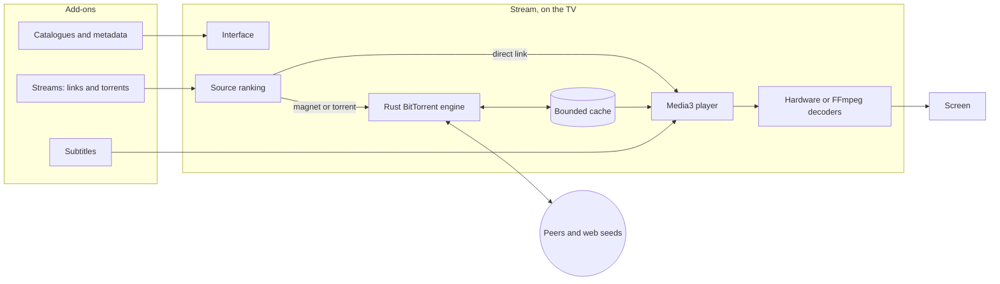
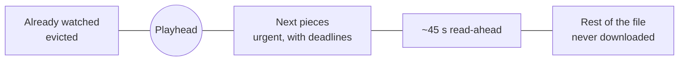

# Stream

**A remote-first Android TV app for films and series, with its own BitTorrent streaming engine built in.**

Catalogues, search, a private library and playback from direct links or torrents, 
using the add-ons you already know. No account, no server, nothing to install on another device.

[Features](#what-it-does) · [How it works](#how-it-works) · [Compared with](#how-it-compares) · [Install](#install) · [Docs](docs/README.md)

Real interface, real data: public-domain films from the Internet Archive, recorded on the Android TV emulator.

## What it does

- **Built for the remote.** Every screen works with the D-pad, OK and Back,
  and with a pointer or touch where there is one. Focus never gets lost, Back
  always does what you expect, and the interface follows tvOS: artwork behind
  the page, a spotlight for the focused title, quiet sounds for each move.
- **Your add-ons, unchanged.** Stream speaks the Stremio add-on protocol:
  catalogue, metadata, stream and subtitle add-ons work as they are, and an
  in-app store with a review page for each one makes installing them a choice
  rather than a surprise.
- **Torrents play like any video.** Press Play and the best source starts on its
  own; seek anywhere and the download jumps there. The engine is part of the
  app, written in Rust, and writes only a small bounded cache, whatever the
  file's size.
- **Plays what the TV can't.** Hardware decoders when the TV has them; bundled
  FFmpeg software decoders for DTS, TrueHD, older codecs and 10-bit video
  when it doesn't.
- **Private by design.** No sign-in, no analytics, no backups of your data.
  Add-on addresses, history and imports are encrypted with a key held by the
  TV's Keystore, and playable stream links are never stored.

<table>
<tr>
<td width="50%"></td>
<td width="50%"></td>
</tr>
<tr>
<td><b>Details</b>: logo, facts and synopsis over the title's art, with Play, Sources, favourite and watched.</td>
<td><b>Search</b>: a keyboard made for the remote, results as you type, a full grid with Right.</td>
</tr>
<tr>
<td></td>
<td></td>
</tr>
<tr>
<td><b>Player</b>: a quiet toolbar with a draggable timeline; subtitles always stay clear of it.</td>
<td><b>Sources</b>: every candidate from your add-ons, ranked, if you'd rather choose yourself.</td>
</tr>
<tr>
<td></td>
<td></td>
</tr>
<tr>
<td><b>Library</b>: favourites and history, kept on the TV.</td>
<td><b>Settings</b>: subtitle style with a live preview, languages, add-ons and playback.</td>
</tr>
</table>

<b>Search and the player in motion</b>

## How it works

Everything runs on the TV. The app asks your add-ons for catalogues and sources
itself, ranks the sources by quality, size, seeders and what played well before,
and starts the best one, moving on to the next if it fails.

For a torrent, the engine downloads only what playback needs:

The pieces just ahead of the playhead get deadlines and go to whichever peers
deliver them soonest; a slow peer's blocks are asked of another, and every
piece is hash-checked before the player reads it. Seeking moves the window,
cancelling requests that no longer matter. Older pieces are evicted, so a
50 GB file streams through a 256 MiB cache. More in [How Stream works](docs/how-it-works.md).

### The engine

| | |
| --- | --- |
| Torrents | v1, v2 and hybrid (BEP 52), magnets with metadata from peers (BEP 9), multi-file |
| Transports | TCP and uTP, with MSE/PE encryption tried first |
| Finding peers | Trackers (HTTP, HTTPS with verified certificates, UDP), DHT, peer exchange, local discovery, web seeds |
| Scheduling | Deadlines for the next pieces, time-critical peer choice, endgame, a standard choker with an optimistic slot |
| Safety | Every piece hash-checked; hostile peers bounded; nothing written outside the cache, which is deleted when you stop |
| Router port mapping | Optional: PCP, NAT-PMP, then UPnP, talking only to your own router |

It is checked against independent clients on loopback (libtorrent, Transmission,
aria2, WebTorrent, librqbit and plain web servers) in both directions; see
[the streaming engine](docs/streaming-engine.md) for results and limits.

## How it compares

| | Stream | Stremio | TorrServe + a player | Kodi + a torrent add-on | Plex / Jellyfin |
| --- | :---: | :---: | :---: | :---: | :---: |
| Made for a TV remote | ✅ | ✅ | depends on the player | ✅ | ✅ |
| Stremio add-ons | ✅ | ✅ | ❌ | ❌ | ❌ |
| Torrents stream inside one app | ✅ | ✅ | ❌ two apps | ✅ | ❌ |
| Open-source streaming engine | ✅ Rust | ❌ closed-source server | ✅ | depends on the add-on | n/a |
| Bounded cache, any file size | ✅ | ✅ | ✅ | depends on the add-on | n/a |
| No other computer or server | ✅ | ✅ | ✅ | ✅ | ❌ |

Stream also handles BitTorrent v2 and hybrid torrents and needs no account of
any kind. What sets it apart is the combination: the add-on ecosystem people already
use, a streaming engine that is part of the app rather than a separate service,
and an interface built only for the television. Stremio streams torrents through
a separate, closed-source server process; TorrServe is a streaming service that
other player apps connect to; Kodi is a general media centre whose torrent
support comes from third-party add-ons; Plex and Jellyfin play files you already
have on a server. Stream is a single app that does one thing.

## Install

Stream runs on Android TV and Google TV devices with Android 8.0 or later.

1. Build the APK for your device (most TVs are `arm64-v8a`), as described in
   [Building and running](docs/development.md#build-an-apk-for-a-tv), and sign
   it with your own key.
2. On the TV, enable developer options and network debugging.
3. From a computer on the same network: `adb connect <tv-address>`, then
   `adb install app-arm64-v8a-release-signed.apk`.

On first start Stream installs Cinemeta (films and series), OpenSubtitles and a
few public torrent add-ons, so it is ready to browse at once; remove any of them
in **Settings → Add-ons**. The built-in **Internet Archive** add-on in the store
offers thousands of public-domain films.

To try it without a TV, `./simulator.sh up` starts a local Android TV emulator,
builds the app and opens it.

## Documentation

- [Using Stream](docs/features.md): screens, add-ons, playback, imports, privacy, settings
- [How Stream works](docs/how-it-works.md): the playback path, torrent streaming, decoding, local data
- [All documentation](docs/README.md): the app in detail, design, the engine, building, testing

## License

Stream is free software under the [GNU General Public License v3.0 or later](LICENSE).
It bundles third-party components under their own licenses (NextLib, FFmpeg, dav1d,
mbedTLS, Media3, the Geist typeface and the Rust crates listed in
[third-party software](docs/third-party.md)); the app's *Open source notices* show them all.

Stream does not host, index or provide any content. Add-ons are third-party
services chosen by the user, who is responsible for what they watch and for
respecting the law and copyright where they live. The media in this README show
public-domain films from the Internet Archive.
