

# Stream

An Android TV app for watching films and series from Stremio add-ons and torrents.

[Releases](https://github.com/Daniil-Hirchyts/stream/releases) · [How it works](#how-it-works) · [Comparison](#comparison) · [Install](#install) · [Docs](docs/README.md)

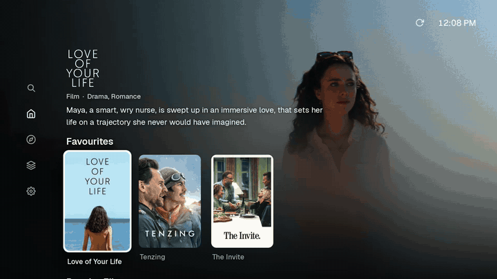

Recorded on the Android TV emulator. Titles and artwork come from the Cinemeta catalogue; the film shown playing is Tears of Steel (2012, © Blender Foundation, CC BY 3.0).

## About

Stream is a TV client for the Stremio add-on protocol with a BitTorrent engine
built into the app, so a torrent source plays directly on the TV without a
separate server or a debrid service. Everything runs on the TV: there is no
account and no backend, and the library and history are stored locally.

It is tuned for low-end hardware first: the reference device is a
first-generation Fire TV Stick (1 GB of RAM, 32-bit ARM).

What it does:

- Browses catalogues and plays streams from Stremio add-ons (catalogue,
  metadata, stream and subtitle add-ons work as they are).
- Streams torrents through its own engine, written in Rust, using a fixed-size
  cache (128, 256 or 512 MiB) whatever the file size. Seeking jumps the
  download to the new position.
- Picks a source automatically by quality, size, seeders and past results, or
  lets you choose from the Sources list.
- Uses hardware decoders when the TV has them and bundled FFmpeg decoders
  otherwise (DTS, TrueHD, 10-bit video, older codecs).
- Keeps favourites, history and add-on settings on the TV, encrypted with a
  Keystore key. Playable stream links are not stored, and Android backup is
  disabled.
- Works with the remote's D-pad, OK and Back, and with touch or a pointer.

<table>
<tr>
<td width="50%">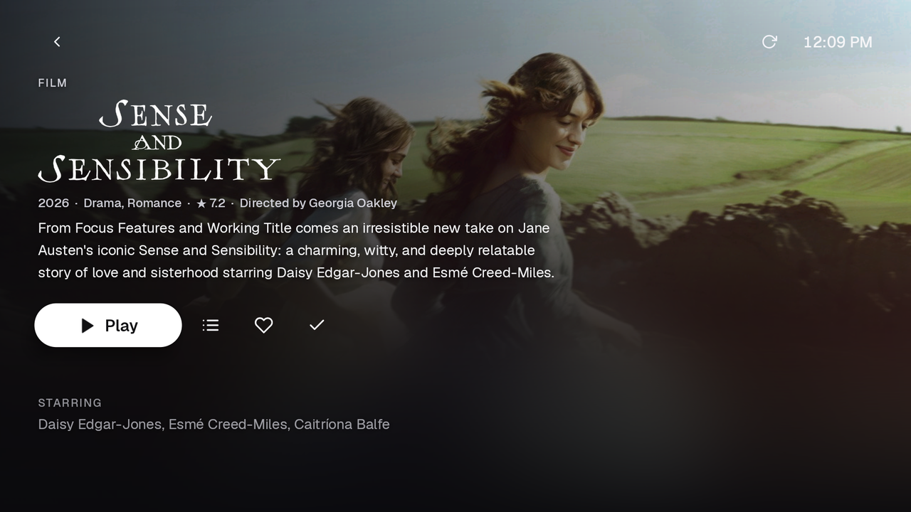</td>
<td width="50%">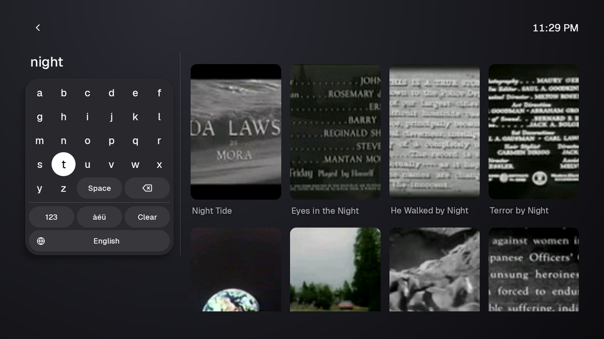</td>
</tr>
<tr>
<td>Details</td>
<td>Search</td>
</tr>
<tr>
<td>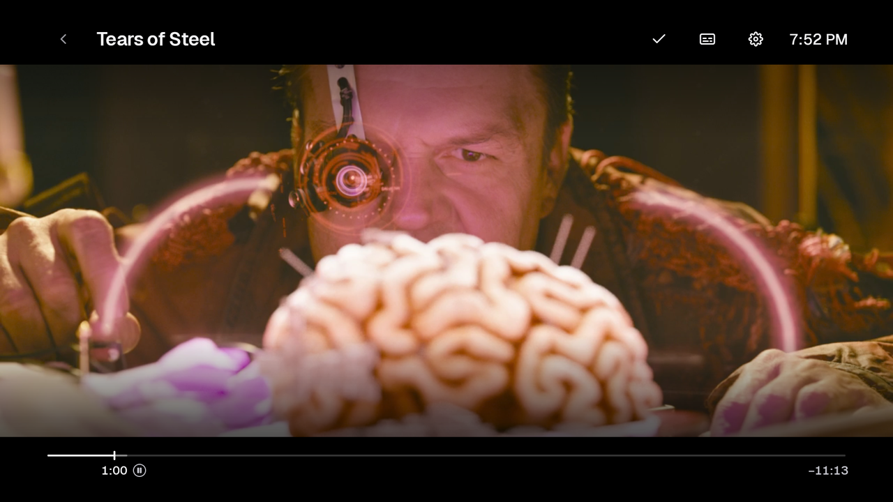</td>
<td>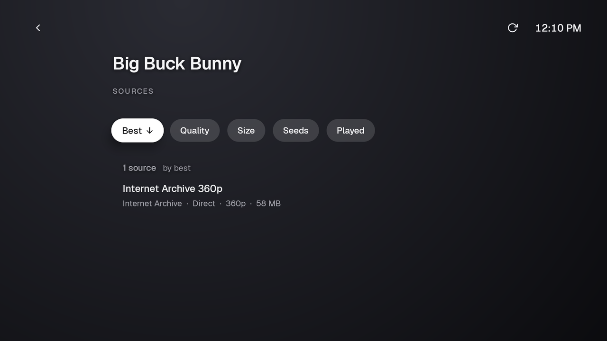</td>
</tr>
<tr>
<td>Player</td>
<td>Sources</td>
</tr>
<tr>
<td>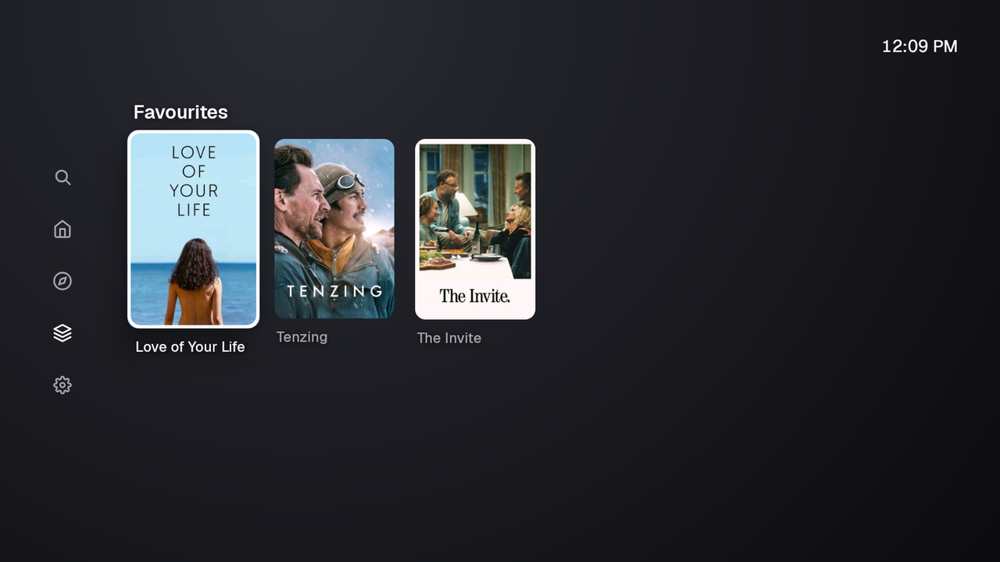</td>
<td>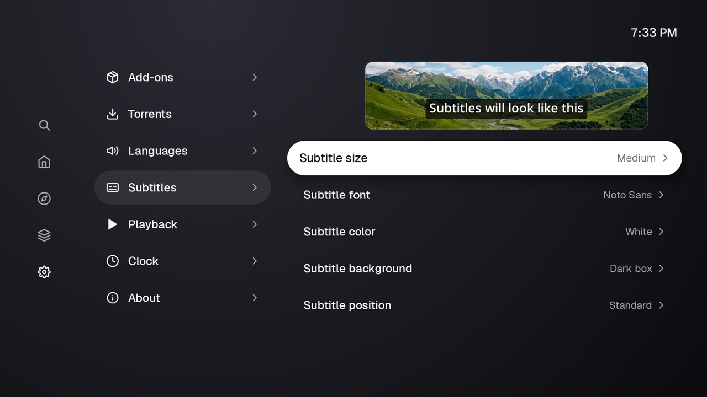</td>
</tr>
<tr>
<td>Library</td>
<td>Subtitle settings</td>
</tr>
</table>

Search and the player in motion

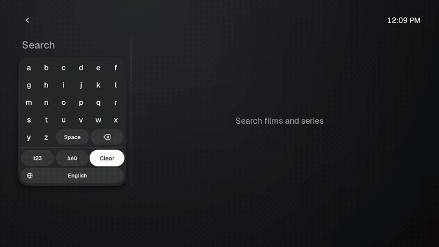

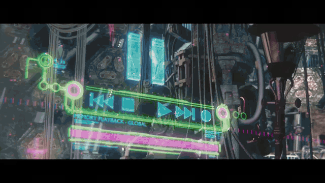

## How it works

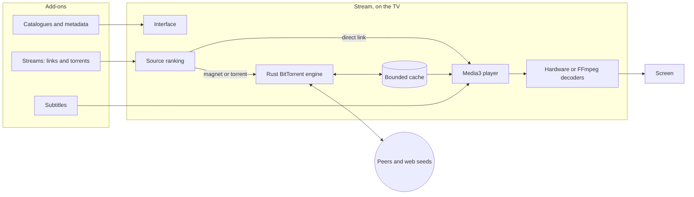

The app queries the installed add-ons directly, ranks the sources it gets back
and starts the best one, falling back to the next if it fails.

For a torrent, the engine only downloads what playback needs:

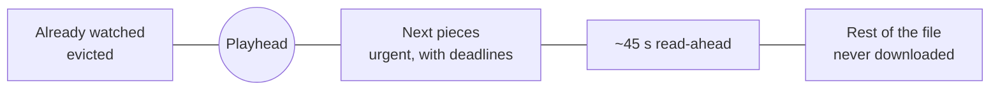

Pieces just ahead of the playhead get deadlines and are requested from the
fastest peers; blocks stuck on a slow peer are re-requested elsewhere, and every
piece is hash-checked before the player reads it. Seeking moves the window and
cancels requests that are no longer needed. Watched pieces are evicted, which is
how a 50 GB file fits through a 256 MiB cache. Details in
[How Stream works](docs/how-it-works.md).

### The engine

| | |
| --- | --- |
| Torrents | v1, v2 and hybrid (BEP 52), magnets with metadata from peers (BEP 9), multi-file |
| Transports | TCP and uTP, with MSE/PE encryption tried first |
| Finding peers | Trackers (HTTP, HTTPS with verified certificates, UDP), DHT, peer exchange, local discovery, web seeds |
| Scheduling | Deadlines for the next pieces, time-critical peer choice, endgame, a standard choker with an optimistic slot |
| Safety | Every piece hash-checked; hostile peers bounded; nothing written outside the cache, which is deleted when playback stops |
| Router port mapping | Optional: PCP, NAT-PMP, then UPnP, talking only to your own router |

It is tested on loopback against libtorrent, Transmission, aria2, WebTorrent,
librqbit and plain web servers in both directions; see
[the streaming engine](docs/streaming-engine.md) for results and known limits.

## Comparison

| | Stream | Stremio | Nuvio TV | TorrServe + a player | Kodi + a torrent add-on | Plex / Jellyfin |
| --- | :---: | :---: | :---: | :---: | :---: | :---: |
| Made for a TV remote | ✅ | ✅ | ✅ | depends on the player | ✅ | ✅ |
| Stremio add-ons | ✅ | ✅ | ✅ | ❌ | ❌ | ❌ |
| Torrents stream inside one app | ✅ | ✅ | ✅ | ❌ two apps | ✅ | ❌ |
| Open-source streaming engine | ✅ Rust | ❌ closed-source server | ✅ libtorrent (C++) | ✅ | depends on the add-on | n/a |
| Bounded cache, any file size | ✅ | ✅ | not documented | ✅ | depends on the add-on | n/a |
| No other computer or server | ✅ | ✅ | ✅ | ✅ | ✅ | ❌ |

Stremio streams torrents through a separate closed-source server process. Nuvio
TV is the most similar project: an open-source Kotlin client for the same
add-ons, built on libtorrent. TorrServe is a streaming service that other
players connect to. Kodi gets torrent support from third-party add-ons. Plex and
Jellyfin play files from your own server.

## Install

Stream needs Android 8.0 or later (Android TV, Google TV or another Android TV
box).

1. Download an APK from the
   [latest release](https://github.com/Daniil-Hirchyts/stream/releases/latest):
   **arm64-v8a** for most current TVs, **armeabi-v7a** for 32-bit sticks such as
   the first Fire TV Stick, or **universal** if unsure. `SHA256SUMS.txt` has the
   checksums.
2. Sideload it with a downloader app on the TV, from a USB drive, or over the
   network with developer options and network debugging enabled:
   `adb connect <tv-address>`, then `adb install stream-<version>-arm64-v8a.apk`.

To build it yourself, see
[Building and running](docs/development.md#build-an-apk-for-a-tv). Releases are
made as described in [Releasing](docs/releasing.md).

On first start Stream installs Cinemeta (films and series), OpenSubtitles and a
few public torrent add-ons. You can remove any of them in **Settings → Add-ons**.
The built-in **Internet Archive** add-on in the store has public-domain films.

To try it without a TV, `./simulator.sh up` starts a local Android TV emulator,
builds the app and opens it.

## Documentation

- [Using Stream](docs/features.md): screens, add-ons, playback, imports, privacy, settings
- [How Stream works](docs/how-it-works.md): the playback path, torrent streaming, decoding, local data
- [All documentation](docs/README.md): the app in detail, design, the engine, building, testing

## License

Stream is free software under the [GNU General Public License v3.0 or later](LICENSE).
It bundles third-party components under their own licenses (NextLib, FFmpeg, dav1d,
mbedTLS, Media3, the Geist typeface and the Rust crates listed in
[third-party software](docs/third-party.md)); the app's *Open source notices* list them all.

Stream does not host, index or provide any content. Add-ons are third-party
services chosen by the user, who is responsible for what they watch and for
respecting the law and copyright where they live. The screenshots and recordings
in this README show titles and artwork from the Cinemeta catalogue as the app
displays them; the only film shown playing is [Tears of Steel](https://mango.blender.org/about/) (2012, © Blender
Foundation, [CC BY 3.0](https://creativecommons.org/licenses/by/3.0/)),
streamed from the Blender Foundation’s own download server.
