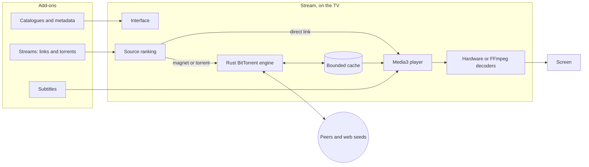
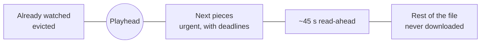

# Stream

**Private, local streaming for Android TV, built to run smoothly on cheap and slow TVs.**

Stream films and series from your Stremio add-ons and from torrents, directly on the TV. 
No account, no cloud, no server, no debrid subscription, no tracking: your data never leaves the TV.

[Download](https://github.com/Daniil-Hirchyts/stream/releases) · [Why Stream](#why-stream) · [How it works](#how-it-works) · [Compared with](#how-it-compares) · [Install](#install) · [Docs](docs/README.md)

Real interface on the Android TV emulator. Titles and artwork come from the Cinemeta catalogue; the only film shown playing is Tears of Steel (2012, © Blender Foundation, CC BY 3.0).

## Why Stream

- **Everything stays on your TV.** There is no Stream account, server or cloud,
  and no analytics. Your library, watch history, add-on addresses and imports
  live only on the TV, encrypted with a key held by its Keystore; playable
  stream links are never stored, and Android backups and device transfer are
  turned off. Uninstalling removes it all.
- **Made for weak hardware.** Stream is designed around a first-generation
  Fire TV Stick: 1 GB of RAM and a 32-bit processor. It keeps one torrent
  active, streams through a small bounded cache (128, 256 or 512 MiB) whatever
  the file's size, loads artwork within tight memory limits and ships startup
  profiles so screens open quickly on slow chips.
- **Torrents without a second app or a debrid service.** The BitTorrent engine
  is part of the app, written in Rust: press Play and the best source starts,
  seek anywhere and the download jumps there. No TorrServe, no desktop client,
  no Real-Debrid or other paid service required (debrid links from your add-ons
  still play if you use one).
- **A Stremio alternative that keeps your add-ons.** Stream speaks the Stremio
  add-on protocol, so catalogue, metadata, stream and subtitle add-ons work as
  they are. The first start installs a small starter set; anything else is
  added only after you review it in the in-app store.
- **Plays what the TV can't.** Hardware decoders when the TV has them, bundled
  FFmpeg software decoders for DTS, TrueHD, older codecs and 10-bit video when
  it doesn't.
- **Free and open source, no ads.** GPL-3.0, no subscriptions, nothing to sign
  up for.
- **Comfortable from the sofa.** Every screen works with the remote's D-pad, OK
  and Back (and with a pointer or touch), with a spotlight that follows the
  focused title and a timeline you can drag.

### Looking for…

- **A Stremio alternative for Android TV or Fire TV?** Stream uses the same
  add-ons, with the torrent engine inside the app instead of a separate server.
- **A way to stream torrents on a TV without TorrServe?** One app does the
  downloading and the playback; nothing to set up on another device.
- **Something that doesn't lag on a cheap box or stick?** Stream's memory, cache
  and decoder choices are set for 1 GB, 32-bit devices first.
- **Streaming without accounts or tracking?** There is nothing to sign in to and
  nothing sent anywhere except requests to the add-ons you installed, the
  artwork they point to and the peers of what you play.

<table>
<tr>
<td width="50%"></td>
<td width="50%"></td>
</tr>
<tr>
<td><b>Details</b>: logo, facts and synopsis over the title's art, with Play, Sources, favourite and watched.</td>
<td><b>Search</b>: a keyboard made for the remote, results as you type, a full grid with Right.</td>
</tr>
<tr>
<td></td>
<td></td>
</tr>
<tr>
<td><b>Player</b>: a quiet toolbar with a draggable timeline; subtitles always stay clear of it.</td>
<td><b>Sources</b>: every candidate from your add-ons, ranked, if you'd rather choose yourself.</td>
</tr>
<tr>
<td></td>
<td></td>
</tr>
<tr>
<td><b>Library</b>: favourites and history, kept on the TV and encrypted.</td>
<td><b>Settings</b>: subtitle style with a live preview, languages, add-ons and playback.</td>
</tr>
</table>

<b>Search and the player in motion</b>

## How it works

Everything runs on the TV. The app asks your add-ons for catalogues and sources
itself, ranks the sources by quality, size, seeders and what played well before,
and starts the best one, moving on to the next if it fails.

For a torrent, the engine downloads only what playback needs:

The pieces just ahead of the playhead get deadlines and go to whichever peers
deliver them soonest; a slow peer's blocks are asked of another, and every
piece is hash-checked before the player reads it. Seeking moves the window,
cancelling requests that no longer matter. Older pieces are evicted, so a
50 GB file streams through a 256 MiB cache. More in [How Stream works](docs/how-it-works.md).

### The engine

| | |
| --- | --- |
| Torrents | v1, v2 and hybrid (BEP 52), magnets with metadata from peers (BEP 9), multi-file |
| Transports | TCP and uTP, with MSE/PE encryption tried first |
| Finding peers | Trackers (HTTP, HTTPS with verified certificates, UDP), DHT, peer exchange, local discovery, web seeds |
| Scheduling | Deadlines for the next pieces, time-critical peer choice, endgame, a standard choker with an optimistic slot |
| Safety | Every piece hash-checked; hostile peers bounded; nothing written outside the cache, which is deleted when you stop |
| Router port mapping | Optional: PCP, NAT-PMP, then UPnP, talking only to your own router |

It is checked against independent clients on loopback (libtorrent, Transmission,
aria2, WebTorrent, librqbit and plain web servers) in both directions; see
[the streaming engine](docs/streaming-engine.md) for results and limits.

## How it compares

| | Stream | Stremio | Nuvio TV | TorrServe + a player | Kodi + a torrent add-on | Plex / Jellyfin |
| --- | :---: | :---: | :---: | :---: | :---: | :---: |
| Made for a TV remote | ✅ | ✅ | ✅ | depends on the player | ✅ | ✅ |
| Stremio add-ons | ✅ | ✅ | ✅ | ❌ | ❌ | ❌ |
| Torrents stream inside one app | ✅ | ✅ | ✅ | ❌ two apps | ✅ | ❌ |
| Open-source streaming engine | ✅ Rust | ❌ closed-source server | ✅ libtorrent (C++) | ✅ | depends on the add-on | n/a |
| Bounded cache, any file size | ✅ | ✅ | not documented | ✅ | depends on the add-on | n/a |
| No other computer or server | ✅ | ✅ | ✅ | ✅ | ✅ | ❌ |

Stream also handles BitTorrent v2 and hybrid torrents and needs no account of
any kind. What sets it apart is the combination: the add-on ecosystem people already
use, a streaming engine that is part of the app rather than a separate service,
and an interface built only for the television. Stremio streams torrents through
a separate, closed-source server process; Nuvio TV is the closest relative, an
open-source (GPL-3.0) Kotlin client for the same add-ons that builds on
libtorrent rather than its own engine; TorrServe is a streaming service that
other player apps connect to; Kodi is a general media centre whose torrent
support comes from third-party add-ons; Plex and Jellyfin play files you already
have on a server. Stream is a single app that does one thing.

## Install

Stream runs on Android TV, Google TV and other Android-based TVs and boxes with
Android 8.0 or later.

1. Download the APK from the
   [latest release](https://github.com/Daniil-Hirchyts/stream/releases/latest):
   **arm64-v8a** for most current TVs, **armeabi-v7a** for 32-bit sticks such as
   the first Fire TV Stick, or **universal** if unsure. Check it against
   `SHA256SUMS.txt`.
2. Install it the way your TV allows sideloading: a downloader app on the TV, a
   USB drive with a file manager, or from a computer on the same network with
   developer options and network debugging enabled:
   `adb connect <tv-address>`, then `adb install stream-<version>-arm64-v8a.apk`.

To build it yourself instead, see
[Building and running](docs/development.md#build-an-apk-for-a-tv); releases are
made as described in [Releasing](docs/releasing.md).

On first start Stream installs Cinemeta (films and series), OpenSubtitles and a
few public torrent add-ons, so it is ready to browse at once; remove any of them
in **Settings → Add-ons**. The built-in **Internet Archive** add-on in the store
offers thousands of public-domain films.

To try it without a TV, `./simulator.sh up` starts a local Android TV emulator,
builds the app and opens it.

## Documentation

- [Using Stream](docs/features.md): screens, add-ons, playback, imports, privacy, settings
- [How Stream works](docs/how-it-works.md): the playback path, torrent streaming, decoding, local data
- [All documentation](docs/README.md): the app in detail, design, the engine, building, testing

## License

Stream is free software under the [GNU General Public License v3.0 or later](LICENSE).
It bundles third-party components under their own licenses (NextLib, FFmpeg, dav1d,
mbedTLS, Media3, the Geist typeface and the Rust crates listed in
[third-party software](docs/third-party.md)); the app's *Open source notices* show them all.

Stream does not host, index or provide any content. Add-ons are third-party
services chosen by the user, who is responsible for what they watch and for
respecting the law and copyright where they live. The screenshots and recordings
in this README show titles and artwork from the Cinemeta catalogue as the app
displays them; the only film shown playing is [Tears of Steel](https://mango.blender.org/about/) (2012, © Blender
Foundation, [CC BY 3.0](https://creativecommons.org/licenses/by/3.0/)),
streamed from the Blender Foundation’s own download server.
