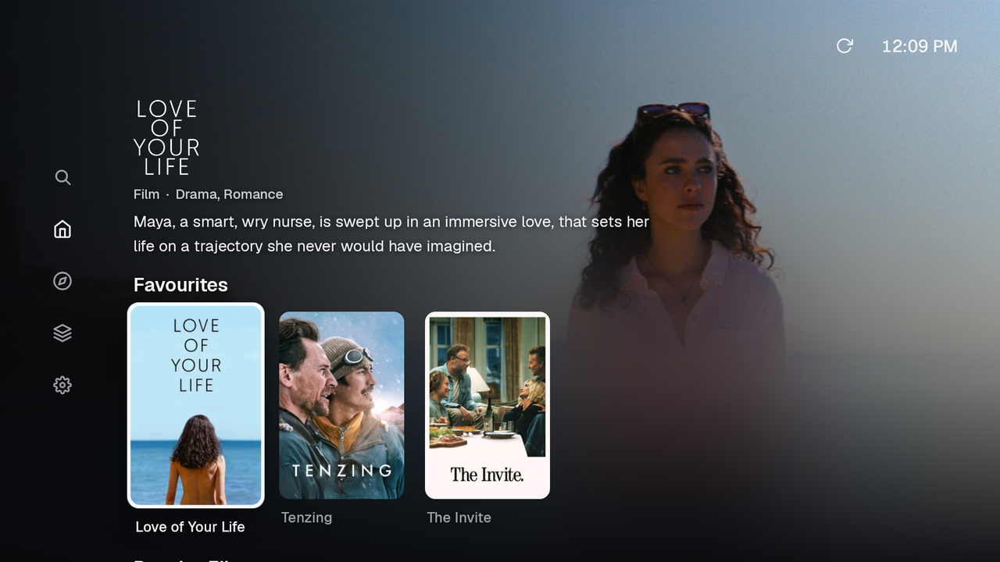
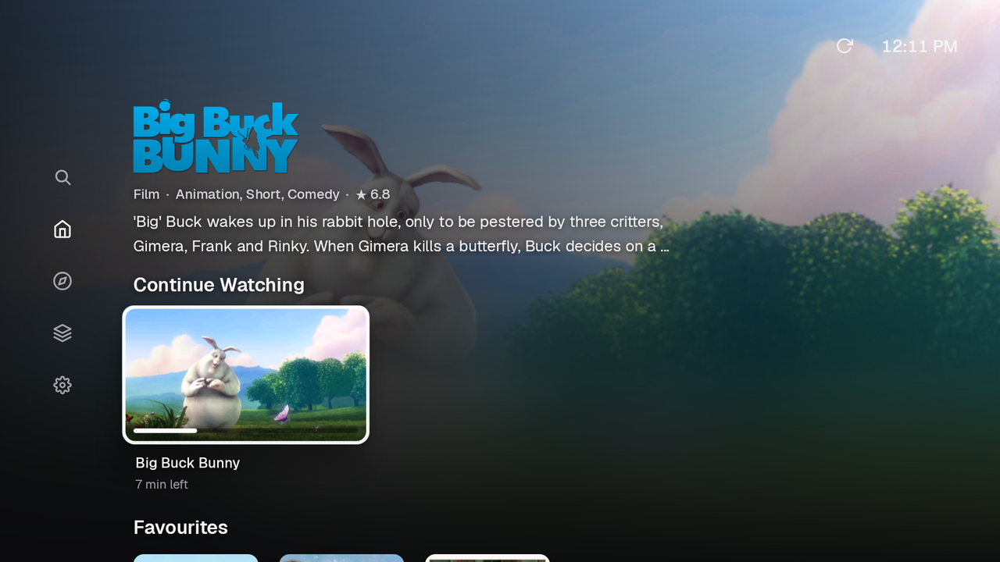
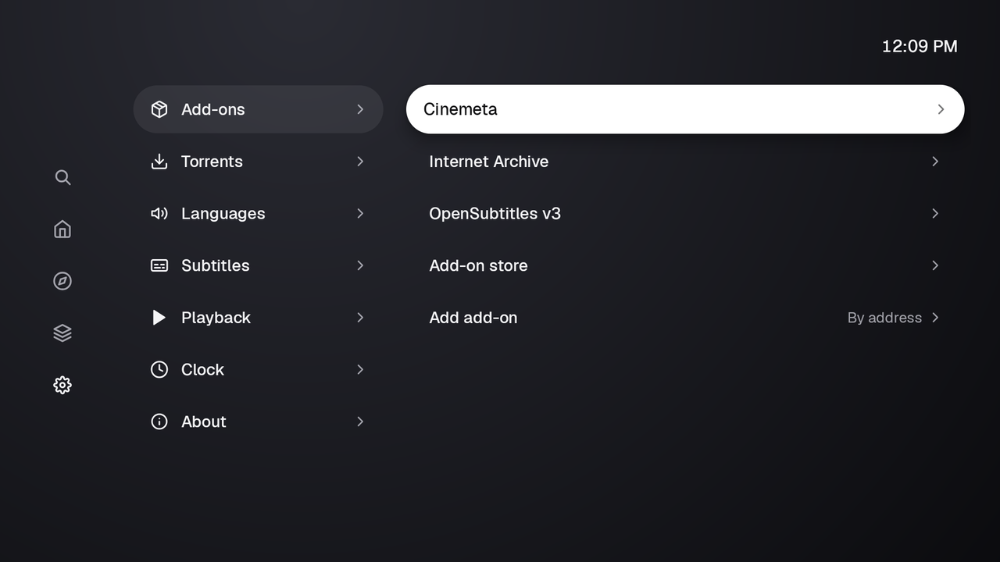
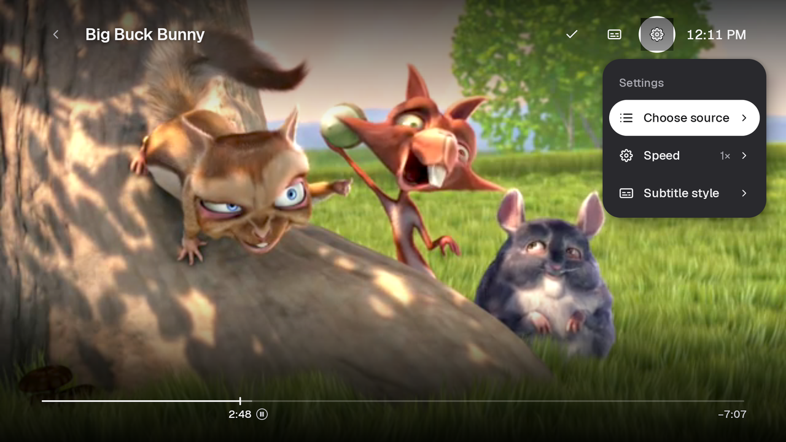

# Using Stream

Stream runs entirely on the TV: there is no account, no server and nothing to
install on another device, and your library and history stay on the TV,
encrypted. It is designed to stay quick on modest hardware, down to 1 GB, 32-bit
sticks. Every screen works with the remote's D-pad, OK and Back, and also with a
pointer or touch where the device has one.

## Finding something to watch

- **Home** opens straight away, with no account or setup. A spotlight shows the
  focused title's logo, facts and description over its artwork, and shelves
  below scroll sideways. *Continue watching*, your favourites and new episodes
  of series you follow come first, then the catalogues of your add-ons.
- **Browse** lists every catalogue your add-ons publish, by type and genre.
- **Search** has an on-screen keyboard sized for a remote, in several
  languages, with numbers and accents on their own pages. Results appear as you
  type; Right moves into a full-width grid of results and Left brings the
  keyboard back. The query and the film you were on are kept when you leave and
  come back.
- **Details** shows the title's artwork, facts, cast, *Play* or *Resume*,
  *Sources*, *Add favourite* and *Mark watched*. Series have seasons and episode
  cards; moving to a season shows its episodes at once.
- **Library** keeps your favourites and watch history on the TV only.

 

## Add-ons

Stream speaks the add-on protocol popularised by Stremio, so existing catalogue,
metadata, stream and subtitle add-ons work unchanged. A new install sets itself
up with Cinemeta (films and series), OpenSubtitles (subtitles) and a set of
public torrent stream add-ons. Anything you remove stays removed.

**Settings → Add-ons** lists what is installed: reorder, disable, hide
individual catalogues or remove an add-on. **Add-on store** browses the public
directory; every add-on shows a review page with what it provides before it is
installed. The built-in **Internet Archive** add-on offers the Archive's
public-domain feature films, streamed directly from archive.org.

## Playing

*Play* picks the best source automatically: it ranks what your add-ons offer by
quality, size, seeders and what played well before, and starts the first that
works, trying the next if one fails. *Sources* lists every candidate, sortable,
for choosing yourself.

- **Direct links** (HTTP/HTTPS) play through Media3.
- **Torrents and magnets** play through Stream's own streaming engine inside
  the app: playback starts once the first pieces arrive, seeking jumps the
  download to the new position, and only a bounded cache (128, 256 or 512 MiB)
  is ever written, whatever the file's size. Nothing is kept after you stop.
- **Formats:** hardware decoders when the TV has them, and bundled FFmpeg
  software decoders for what it lacks (for example DTS, TrueHD, older video
  codecs or 10-bit video on older chips).

In the player, OK pauses and resumes, Left/Right skip, and the toolbar has the
timeline (drag it with a pointer), *Audio & subtitles*, *Settings* and *Mark
watched*. Subtitles come from the file, the source or your subtitle add-ons;
their size, font, colour, background and position are adjustable, and stay
above the toolbar. Near the end of an episode the next one is offered, and
played automatically if you allow it. Progress is saved as you watch and
survives the app being closed or the TV restarting.

## Your own sources

**Settings → Torrents → Imports** accepts a magnet link or a `.torrent` URL and
adds it to the library privately: imports never leave the TV.

## Privacy

- No account, sign-in or server of Stream's own; no analytics.
- Add-on addresses, metadata, imports and preferences are encrypted with a key
  held by Android's Keystore. Backups and device-to-device transfer are off.
- Playable stream addresses are never stored; resuming looks them up again.
- Add-on addresses are never written to logs with their path or query (where
  personal configuration usually lives).
- **Router port mapping** (PCP, NAT-PMP or UPnP, to let other peers connect to
  you) is off unless you turn it on in **Settings → Playback**, and then only
  ever talks to your own router.

## When something goes wrong

Every failure says what happened and offers Retry or another source. With
**Settings → About → Developer mode** on, failures also show an error report as
a QR code: scan it with a phone to read the details, with nothing uploaded
anywhere.

## Settings at a glance

| Area | What you can set |
| --- | --- |
| Add-ons | Installed add-ons, order, catalogues shown, the add-on store |
| Languages | Preferred audio and subtitle languages, keyboard languages |
| Subtitles | Size, font, colour, background, position, with a live preview |
| Playback | Cache size, play next episode, interface sounds, router port mapping, clear caches |
| Clock | Clock format, clock in the player |
| About | Version, open source notices, developer mode |
