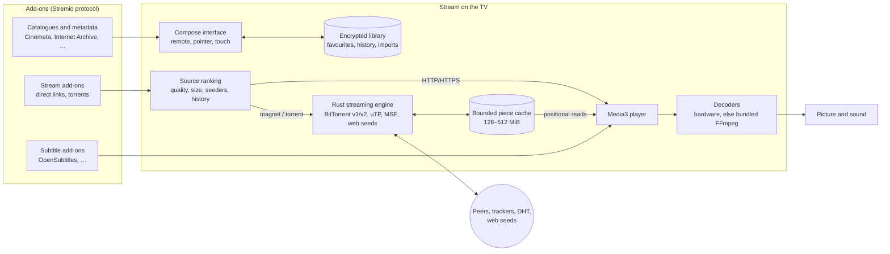
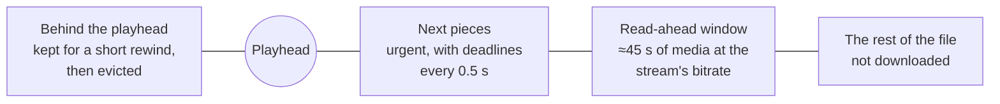
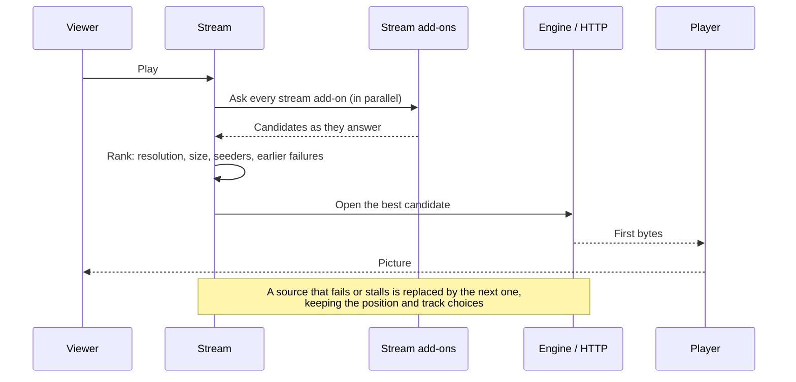

# How Stream works

## From a catalogue to the screen

Everything runs inside the app. There is no companion server, desktop helper,
account or cloud service: the TV fetches add-on data itself, and torrents are
downloaded by the engine compiled into the app.

## Streaming a torrent

The engine downloads only what playback needs, around the position being read,
and keeps it in a small cache that never grows with the file.

1. A torrent is added with nothing to download. A magnet's metadata comes from
   peers (BEP 9); a v2 torrent's piece layers too (BEP 52).
2. Choosing a file starts the read-ahead controller. From the newest reader's
   position it keeps about 45 seconds of media at download priority, bounded by
   the cache. The pieces the player waits for, and the next two, get deadlines.
3. Urgent pieces go to the peers that deliver them soonest, and a block one peer
   is slow to send is asked of another. When nothing new is left to request,
   endgame asks for outstanding blocks twice and cancels the slower copy.
4. Every piece is hash-checked (SHA-1 for v1, SHA-256 Merkle trees for v2)
   before the player can read it.
5. Pieces that fall out of the window are evicted to make room; peers are told
   (lt_donthave) so they don't ask for them.
6. A seek moves the window: requests for pieces that left it are cancelled, and
   the new position's pieces become urgent at once.

## Pressing Play

Browsing never starts a download: Details may look up sources ahead of time so
*Play* is instant, but no engine is created and no payload is fetched until you
press it.

## Decoding

Media3 plays every source. The TV's hardware decoders are used when they can
handle the format; otherwise bundled FFmpeg software decoders (through NextLib)
take over for audio such as DTS, TrueHD and E-AC-3 variants, and for video
codecs or bit depths the hardware lacks. Software video is converted straight
into the display surface. See [decoders](decoders.md).

## What stays on the TV

| Kept | Where | Protection |
| --- | --- | --- |
| Add-ons and their configuration | SQLite | AES-GCM, Android Keystore key |
| Favourites, history, progress | SQLite | AES-GCM for metadata |
| Imports (magnets, torrent URLs) | SQLite | AES-GCM |
| Preferences | SQLite and app preferences | AES-GCM where stored in SQLite |
| Torrent payload | Bounded cache files | Deleted when playback ends |
| Playable stream addresses | Never stored | |

Backups and device-to-device transfer are disabled. See
[the Android app](app.md#local-data) for details.
